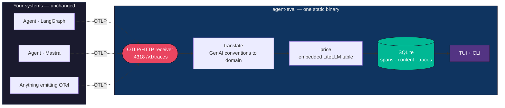
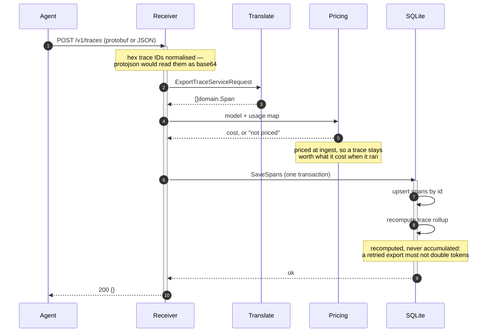
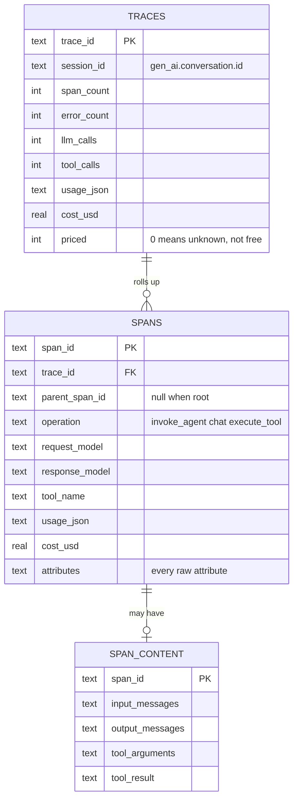
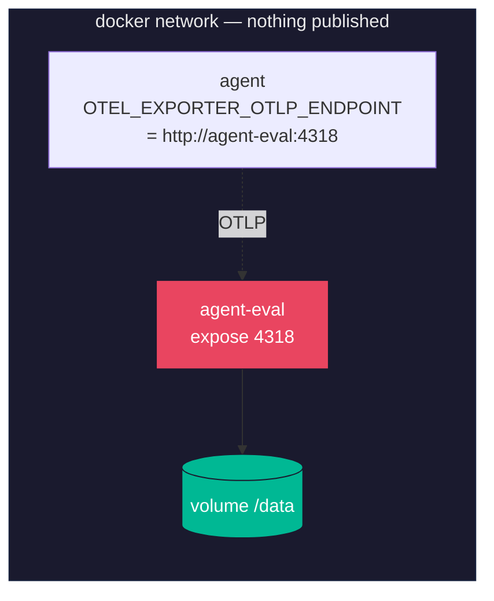

# agent-eval-tui

[](https://github.com/FullFran/agent-eval-tui/actions/workflows/ci.yml)


**LLM and agent observability in one static binary and one SQLite file.**

Point any OpenTelemetry exporter at it and see what your agents actually do:
which model, which tools, how many tokens, how much money, and where it broke.
No server, no Postgres, no browser.

```
agent-eval  ·  traces

  ROOT                      WHEN   TOOK   LLM  TOOL    TOKENS       COST
▸ invoke_agent soporte     12s ago  4.5s     1     1      2992    $0.0205  ✗
  invoke_agent research     1m ago 12.1s     6     9     48210    $0.3140
  invoke_agent soporte      4m ago  2.2s     1     0      1204    $0.0071

  ↑/↓ move · enter open · s sessions/traces · r reload · q quit
```

---

## Sixty seconds

```bash
go build -o agent-eval ./cmd/agent-eval
./agent-eval serve &          # OTLP/HTTP on :4318
./agent-eval                  # the TUI
```

Then point an agent at it. **No code change** — it already speaks
OpenTelemetry:

```bash
OTEL_EXPORTER_OTLP_ENDPOINT=http://127.0.0.1:4318
OTEL_EXPORTER_OTLP_PROTOCOL=http/protobuf
OTEL_SERVICE_NAME=my-agent
```

That is the whole setup. The collector and the reader share one default
database under `~/.local/share/agent-eval/`, so `serve` in one terminal and
`agent-eval` in another agree without a single flag.

---

## How it fits together



The dashed arrows are the only integration. Nothing is installed into the
agent, and nothing about it changes.

### What happens to one export



---

## What it captures

Straight from the OpenTelemetry **GenAI semantic conventions**, so an
instrumented agent needs no adaptation:

| From the conventions | Stored as |
|---|---|
| `gen_ai.operation.name` (`invoke_agent`, `chat`, `execute_tool`) | Operation, and whether the span is an LLM or a tool call |
| `gen_ai.request.model`, `gen_ai.response.model` | Requested and resolved model — they differ, and cost belongs to what ran |
| `gen_ai.usage.*` | Usage map: input, output, cached, and whatever a provider adds next |
| `gen_ai.tool.name` | Which tool, how often, how long |
| `gen_ai.provider.name` / `gen_ai.system` | Provider |
| `gen_ai.conversation.id` | Session, grouping the many traces of one multi-turn interaction |
| `gen_ai.input.messages`, `gen_ai.output.messages`, `gen_ai.system_instructions` | Content, in its own table |
| `gen_ai.tool.call.arguments`, `gen_ai.tool.call.result` | Tool payloads, in that same table |
| Span status | Errors, counted per trace |

Spans that follow **none** of the conventions are still stored and still placed
in the tree, just with fewer semantics. Degrade, never reject.

### The data model



Three decisions worth knowing:

- **Content is a separate table.** It is the only place personal data can
  appear, so a retention policy has exactly one table to delete from without
  losing a single measurement.
- **Every attribute is also kept raw.** The conventions are still moving; when
  they move again a column can be backfilled from stored data instead of asking
  everyone to re-run their agents.
- **Trace rollups are recomputed, never accumulated.** Exporters retry and batch
  out of order, so `+= tokens` would double-count on redelivery.

---

## Cost

Prices are **not** hand-written. The
[LiteLLM pricing dataset](https://github.com/BerriAI/litellm) is embedded as a
snapshot, so a fresh binary prices ~1,600 models with no configuration.
Regenerate with `./scripts/update-pricing.sh`.

A table someone types by hand is stale the week after, and a stale price is
worse than no price: it prints a confident wrong number that nobody re-checks.

Two details that matter more than they look:

- **Cached input is priced separately.** At roughly a tenth of fresh input, an
  agent reusing a long system prompt has a cost profile that two integer
  columns cannot express.
- **"Not priced" prints `-`, never `$0.0000`.** A model missing from the dataset
  must not read as a free one.

Negotiated rates are in no public dataset, so `-pricing overrides.json` layers
on top rather than replacing:

```json
{ "models": { "claude-sonnet-4-5": { "per_million": { "input_tokens": 2.4, "output_tokens": 12.0 } } } }
```

---

## Using it

```bash
agent-eval                 # TUI
agent-eval serve           # receive OTLP on :4318
agent-eval traces          # list recent traces
agent-eval trace <id>      # one trace as a span tree
agent-eval sessions        # multi-turn sessions
```

Everything reads the same database. `-db <path>` or `AGENT_EVAL_DB` overrides it
for all of them at once.

### In the TUI

| Key | |
|---|---|
| `↑` `↓` / `k` `j` | move |
| `enter` | open the selected trace |
| `esc` | back to the list |
| `s` | toggle traces / sessions |
| `r` | reload now |
| `q` | quit |

The list refreshes itself every few seconds. The detail view deliberately does
not: a finished trace does not change, and reloading under the cursor while
someone is reading is worse than slightly stale data.

```
agent-eval  ·  trace 0a0b0c0d0e0f1011

  service hagabox   3 spans · 1 llm · 1 tools   4.5s · 2992 tokens · $0.0205

  • invoke_agent soporte    4.5s
  │ • chat                  claude-sonnet-4-5 · 2480/512 tok · $0.0205 · 1.9s
  │ ✗ execute_tool          buscar_pedido · 800ms   upstream 504
```

---

## Deploying it next to your agents

Three ways, in order of how little they ask of you:

| | |
|---|---|
| **A binary** | `CGO_ENABLED=0 go build` gives one static file. Copy it, done. No runtime, no libc |
| **A container** | 23 MB, `FROM scratch`, non-root. See `compose.example.yml` |
| **A sidecar** | Add the service to the compose file your agent already uses and point the agent at it by name |



**Do not publish :4318 on a public interface.** Ingest is unauthenticated, so
anything that can reach it can write into your database. Use `expose`, not
`ports`.

`OTEL_EXPORTER_OTLP_PROTOCOL=http/protobuf` is required until gRPC lands
([#8](https://github.com/FullFran/agent-eval-tui/issues/8)): several SDKs
default to gRPC on :4317 and will fail against an HTTP-only collector, which
reads as "this tool is broken" rather than "wrong transport".

One trap if you copy the Dockerfile: `scratch` has no shell, so `/data` must be
created **at build time with the runtime uid as its owner**. Docker seeds a
named volume from the image directory including ownership, and getting it wrong
produces `apply schema: unable to open database file` — which reads like a
SQLite fault and is a permissions one.

---

## Getting spans out of your agents

Already emitting OpenTelemetry? Three environment variables and you are done.
Not yet, or the LLM spans have no model and no tokens on them?

**→ [docs/instrumenting-your-agents.md](docs/instrumenting-your-agents.md)** — a
tutorial for NestJS, Mastra, LangGraph.js, FastAPI and n8n, including the
`gen_ai.*` attributes that auto-instrumentation does not add for you and a
troubleshooting table for when nothing arrives.

---

## The seam: speak OTLP, demand nothing

Most evaluation tools ship an SDK and ask the agent to adopt it — import the
library, decorate the functions, restructure the loop. That is a real cost, and
it is paid by exactly the people least willing to pay it: teams whose agent
already works in production.

Speaking OTLP inverts that. OpenTelemetry is already the instrumentation
standard, already emitted by the frameworks worth evaluating. An agent that
emits OTel points its exporter at a different address and is observed. Zero
adoption cost is not a nice property; it is the whole product.

It also means this repository does not invent a schema, argue for it, or
maintain an adapter per framework. Standing on a standard is less work **and**
more general, which is a rare combination and worth taking when it appears.

## Why it exists: one run is not a measurement

Almost every agent benchmark executes a case once, takes the number and plots
it:

```
A: 0.82    B: 0.79
```

With a stochastic model that is noise wearing a lab coat. Is B worse, or did
that run go badly? Nothing in the output can tell you.

```
A − B = 0.03 ± 0.01    n = 30
```

Repeated sampling, variance, intervals, and a stated answer to "is this
difference real?". Ordinary practice in experimental physics and strangely rare
here.

## Evaluating trajectories, not just answers

Scoring the final answer misses how agents actually fail. The failures are in
the path: loops, the wrong tool, giving up early, calling six tools where one
would do.

| | Single answer | Agent trajectory |
|---|---|---|
| What is measured | The output | Which tools, in what order, how many steps |
| Typical failures | Wrong content | Loops, wrong tool, premature stop, over-calling |
| Metrics | Accuracy, quality | Task success, steps to resolve, wasted calls, cost per resolved task |
| Existing tools | Many | Few worth using |

The second column is where the value is and where the competition is thin.

## Scoring, in order of preference

1. **Programmatic assertion** — cheap, deterministic, trustworthy.
2. **Exact or fuzzy match**.
3. **LLM as judge** — last resort, and only with its agreement against human
   judgement measured on a sample.

An unvalidated judge is an invented number with extra steps.

---

## Status

**Observability works.** OTLP over HTTP (protobuf and JSON), GenAI attributes
mapped, cost from LiteLLM, sessions, SQLite, a TUI and a CLI. CI vets,
race-tests, builds the static binary and drives it end to end with a real OTLP
payload.

**Evaluation does not exist yet.** `Case`, `Run` and `Judgement` are open in
[#1](https://github.com/FullFran/agent-eval-tui/issues/1); repeated sampling in
[#3](https://github.com/FullFran/agent-eval-tui/issues/3). Today this answers
*"what did the agent do"*. It does not yet answer *"is B actually worse than
A"*, which is the question the repository exists for.

Three bugs found while building it, all worth knowing if you write an OTLP
receiver of your own:

- **OTLP/JSON encodes trace and span IDs as hex; `protojson` decodes `bytes`
  fields as base64.** A real payload produces a different, valid-looking ID for
  every span — no error, and children stop joining their parents. The test that
  should have caught it built its input with `protojson.Marshal`, so it agreed
  with the bug.
- **An absent parent arrives as eight zero bytes**, not an empty field, so
  hex-encoding made every root span look like the child of a span that does not
  exist.
- **`scratch` images need the data directory created at build time**, owned by
  the runtime uid, or the container starts and dies on a permissions error that
  reads like a SQLite one.

---

Built by [Francisco Olmedo](https://github.com/FullFran). MIT.
