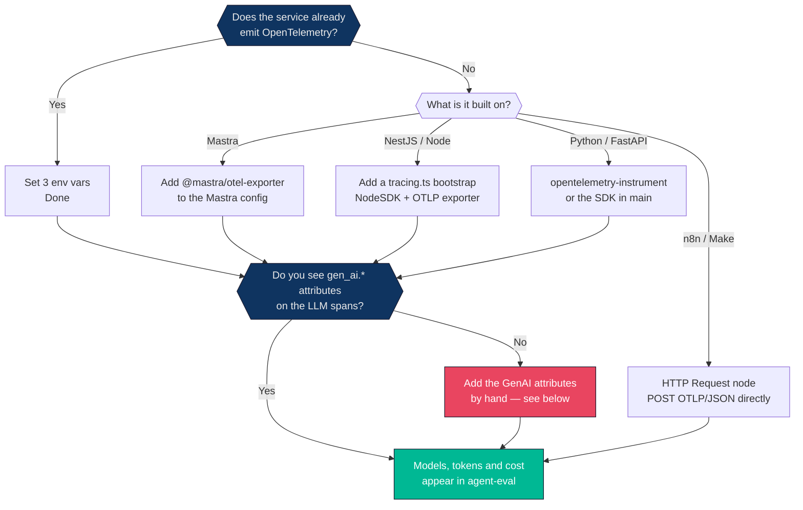
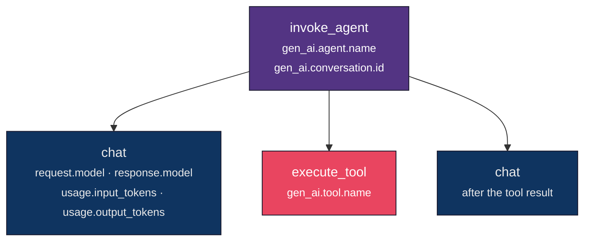
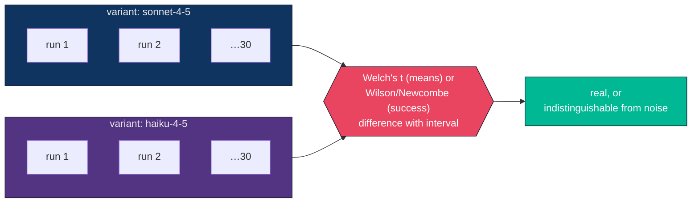

# Instrumenting your agents

How to get spans out of the systems we actually run — NestJS, Mastra,
LangGraph.js, FastAPI and n8n — and into `agent-eval`.

The short version: **you are probably closer than you think.** OpenTelemetry is
already in most of these stacks. In several cases this is three environment
variables and nothing else.

---

## Which path is yours



The second question is the one people skip. Auto-instrumentation gives you HTTP
and database spans for free, but **it does not know your LLM call is an LLM
call**. Without `gen_ai.*` attributes you get a trace tree with no model, no
tokens and no cost — which is a much less useful tool.

---

## 0. The three variables

Whatever the stack, this is where the traces go:

```bash
OTEL_EXPORTER_OTLP_ENDPOINT=http://agent-eval:4318
OTEL_EXPORTER_OTLP_PROTOCOL=http/protobuf
OTEL_SERVICE_NAME=hagabox
```

`OTEL_SERVICE_NAME` is not optional in practice. Without it every trace arrives
as `unknown_service` and stops being attributable the moment you run two agents.

`OTEL_EXPORTER_OTLP_PROTOCOL` is required until gRPC lands
([#8](https://github.com/FullFran/agent-eval-tui/issues/8)). Several SDKs default
to gRPC on :4317 and fail against an HTTP-only collector with an error that
reads like the tool is broken.

---

## 1. NestJS and plain Node

Create `src/tracing.ts`:

```ts
import { NodeSDK } from '@opentelemetry/sdk-node';
import { OTLPTraceExporter } from '@opentelemetry/exporter-trace-otlp-proto';
import { getNodeAutoInstrumentations } from '@opentelemetry/auto-instrumentations-node';

const sdk = new NodeSDK({
  // No arguments: the exporter reads OTEL_EXPORTER_OTLP_ENDPOINT itself, so the
  // deployment owns the address rather than the code.
  traceExporter: new OTLPTraceExporter(),
  instrumentations: [getNodeAutoInstrumentations()],
});

sdk.start();

// Without this, spans buffered at the moment of a rolling restart are lost —
// which is precisely the traffic you most want to see.
process.on('SIGTERM', () => {
  sdk.shutdown().finally(() => process.exit(0));
});
```

Install:

```bash
npm i @opentelemetry/sdk-node \
      @opentelemetry/exporter-trace-otlp-proto \
      @opentelemetry/auto-instrumentations-node
```

Then import it **first**, before anything else, in `src/main.ts`:

```ts
import './tracing';        // must be the first import
import { NestFactory } from '@nestjs/core';
// …
```

Order matters and is the usual reason "it exports nothing". Auto-instrumentation
patches modules as they load; anything imported before the SDK started is
already loaded and never gets patched.

---

## 2. The part that actually matters: GenAI attributes

Auto-instrumentation will give you an HTTP span for the call to Anthropic. It
will not tell `agent-eval` that it was a model call, which model, or how many
tokens it burned. Those are the
[GenAI semantic conventions](https://opentelemetry.io/docs/specs/semconv/gen-ai/),
and they are what turn a trace tree into an observability tool.

A small helper, and you are done:

```ts
import { trace, SpanStatusCode } from '@opentelemetry/api';

const tracer = trace.getTracer('hagalink-agents');

export async function tracedChat(model: string, call: () => Promise<any>) {
  return tracer.startActiveSpan('chat', async (span) => {
    span.setAttribute('gen_ai.operation.name', 'chat');
    span.setAttribute('gen_ai.provider.name', 'anthropic');
    span.setAttribute('gen_ai.request.model', model);

    try {
      const res = await call();

      // The resolved model, not the requested one: you ask for
      // "claude-sonnet-4-5" and get "claude-sonnet-4-5-20260101" back. Cost
      // belongs to what actually ran.
      span.setAttribute('gen_ai.response.model', res.model ?? model);
      span.setAttribute('gen_ai.usage.input_tokens', res.usage.input_tokens);
      span.setAttribute('gen_ai.usage.output_tokens', res.usage.output_tokens);

      // Cached input bills at roughly a tenth of fresh input. Omit this and the
      // cost of any agent with a long reused system prompt is wrong upward.
      if (res.usage.cache_read_input_tokens) {
        span.setAttribute(
          'gen_ai.usage.cache_read_input_tokens',
          res.usage.cache_read_input_tokens,
        );
      }
      return res;
    } catch (err) {
      span.recordException(err as Error);
      span.setStatus({ code: SpanStatusCode.ERROR, message: String(err) });
      throw err;
    } finally {
      span.end();
    }
  });
}
```

Tool calls are the same shape:

```ts
tracer.startActiveSpan('execute_tool', async (span) => {
  span.setAttribute('gen_ai.operation.name', 'execute_tool');
  span.setAttribute('gen_ai.tool.name', 'buscar_pedido');
  // …
});
```

And the agent turn that wraps them:

```ts
span.setAttribute('gen_ai.operation.name', 'invoke_agent');
span.setAttribute('gen_ai.agent.name', 'soporte');
// Groups every trace of one conversation into a session:
span.setAttribute('gen_ai.conversation.id', conversationId);
```

That is the complete vocabulary. Three operations, a model, some counters:



### Prompts and completions

Content is opt-in in the conventions because prompts and completions can carry
personal data:

```ts
span.setAttribute('gen_ai.input.messages', JSON.stringify(messages));
span.setAttribute('gen_ai.output.messages', JSON.stringify(output));
```

`agent-eval` stores these in their own table, so a retention policy has exactly
one table to delete from without losing a single metric. **Turn it on where it
is acceptable and leave it off where it is not** — everything else works either
way.

---

## 3. Mastra

Mastra exports OTLP through `@mastra/otel-exporter`:

```ts
import { Mastra } from '@mastra/core/mastra';
import { OtelExporter } from '@mastra/otel-exporter';

export const mastra = new Mastra({
  observability: {
    configs: {
      otel: {
        serviceName: 'hagabox',
        exporters: [
          new OtelExporter({
            provider: {
              custom: {
                endpoint: 'http://agent-eval:4318/v1/traces',
                protocol: 'http/protobuf',
              },
            },
          }),
        ],
      },
    },
  },
});
```

Note the endpoint here is the **full path** including `/v1/traces`, unlike the
`OTEL_EXPORTER_OTLP_ENDPOINT` variable, which the SDK appends to. Getting that
wrong gives a 404 per export and an empty database.

```bash
npm i @mastra/otel-exporter
```

---

## 4. LangGraph.js

LangGraph runs on Node, so the `tracing.ts` bootstrap from section 1 covers
transport. What it will not do on its own is emit `gen_ai.*` — wrap the model
node with the helper from section 2, and give the graph invocation an
`invoke_agent` span:

```ts
await tracer.startActiveSpan('invoke_agent', async (span) => {
  span.setAttribute('gen_ai.operation.name', 'invoke_agent');
  span.setAttribute('gen_ai.agent.name', 'gdr');
  span.setAttribute('gen_ai.conversation.id', threadId);
  try {
    return await graph.invoke(input, config);
  } finally {
    span.end();
  }
});
```

Check LangChain's own callback-to-OTel integration before writing much of this
by hand — it moves fast, and if it already emits the conventions the wrapper is
wasted work.

---

## 5. Python and FastAPI

The zero-code path first:

```bash
pip install opentelemetry-distro opentelemetry-exporter-otlp
opentelemetry-bootstrap -a install

OTEL_SERVICE_NAME=ai-hagamodels \
OTEL_EXPORTER_OTLP_ENDPOINT=http://agent-eval:4318 \
OTEL_EXPORTER_OTLP_PROTOCOL=http/protobuf \
opentelemetry-instrument uvicorn app.main:app
```

That gives HTTP and database spans. For the model calls, same idea as the TS
helper:

```python
from opentelemetry import trace

tracer = trace.get_tracer("hagalink-agents")

with tracer.start_as_current_span("chat") as span:
    span.set_attribute("gen_ai.operation.name", "chat")
    span.set_attribute("gen_ai.provider.name", "anthropic")
    span.set_attribute("gen_ai.request.model", model)

    response = client.messages.create(model=model, messages=messages)

    span.set_attribute("gen_ai.response.model", response.model)
    span.set_attribute("gen_ai.usage.input_tokens", response.usage.input_tokens)
    span.set_attribute("gen_ai.usage.output_tokens", response.usage.output_tokens)
```

---

## 6. n8n and low-code

There is no SDK to install, but `agent-eval` accepts **OTLP/JSON**, so an HTTP
Request node can post a span directly.

`POST http://agent-eval:4318/v1/traces`, content type `application/json`:

```json
{
  "resourceSpans": [{
    "resource": { "attributes": [
      { "key": "service.name", "value": { "stringValue": "n8n-flujo-facturas" } }
    ]},
    "scopeSpans": [{ "spans": [{
      "traceId": "{{ $json.traceId }}",
      "spanId": "{{ $json.spanId }}",
      "name": "chat",
      "startTimeUnixNano": "{{ $json.startNs }}",
      "endTimeUnixNano": "{{ $json.endNs }}",
      "attributes": [
        { "key": "gen_ai.operation.name", "value": { "stringValue": "chat" } },
        { "key": "gen_ai.request.model", "value": { "stringValue": "gpt-4o" } },
        { "key": "gen_ai.usage.input_tokens", "value": { "intValue": "1200" } },
        { "key": "gen_ai.usage.output_tokens", "value": { "intValue": "340" } }
      ]
    }]}]
  }]
}
```

Two rules the format enforces:

- **`traceId` is 32 hex characters and `spanId` is 16.** Not a UUID with dashes,
  not a random string of the wrong length. Generate them as hex.
- **Timestamps are Unix *nanoseconds*, as strings.** Milliseconds silently
  produce a trace dated 1970, which sorts to the bottom of the list and looks
  like the export never arrived.

---

## 7. Claude Code

Claude Code already exports OpenTelemetry, but as **log events**, not spans:
one `claude_code.api_request` per model request, one `claude_code.tool_result`
per tool call, with no trace or span ids. agent-eval accepts them on
`/v1/logs` and rebuilds each run as a trace, so the trace list, sessions, cost
and `compare` work exactly as for any other agent.

```bash
CLAUDE_CODE_ENABLE_TELEMETRY=1
OTEL_LOGS_EXPORTER=otlp
OTEL_EXPORTER_OTLP_ENDPOINT=http://127.0.0.1:4318
OTEL_EXPORTER_OTLP_PROTOCOL=http/json          # http/protobuf works too
OTEL_RESOURCE_ATTRIBUTES=agent_eval.case=fix-typo,agent_eval.variant=baseline,agent_eval.run=r1
```

If these already live in the `env` block of your `settings.json`, that block
wins over the shell. Override it for one run with
`claude -p ... --settings '{"env":{"OTEL_EXPORTER_OTLP_ENDPOINT":"http://127.0.0.1:4318"}}'`.

What becomes what:

| Event | Span | Notes |
|---|---|---|
| `api_request` | LLM call | model, input/output/cache tokens, and **Claude Code's own `cost_usd`**, which prices the 5-minute and 1-hour cache tiers a generic table cannot tell apart |
| `tool_result` | tool call | error when `success` is `"false"` |
| `api_error` | error | counted even if a retry later succeeded: the span describes that attempt |
| anything else | ignored | hook, plugin and MCP registration chatter |

One trace per `agent_eval.run`, or per `session.id` when no run is set. Ids are
derived from the events, so a retried export lands on the same spans. Account
identity (`user.email`, `user.id`, `user.account_uuid`, `user.account_id`,
`organization.id`) is dropped before storage.

A headless `claude -p` flushes its events on exit; no export interval tuning is
needed for short runs.

Note that `success` for these traces still means "no span errored", and a
failed `grep` is a failed tool call. Judge a coding run by its acceptance check,
not by this.

---

## Check it worked

```bash
agent-eval traces
```

```
TRACE                              ROOT                  DURATION SPANS   LLM  TOOL    TOKENS       COST
0a0b0c0d0e0f10111213141516171819   invoke_agent soporte      4.5s     3     1     1      2992    $0.0205
```

If `LLM` is 0 or `COST` is `-`, transport is fine and the `gen_ai.*` attributes
are missing. Go back to section 2.

## When nothing arrives

| Symptom | Cause |
|---|---|
| Connection refused | The SDK went to gRPC on :4317. Set `OTEL_EXPORTER_OTLP_PROTOCOL=http/protobuf` |
| 404 on every export | Endpoint already ends in `/v1/traces` and the SDK appended it again — or Mastra's, which needs the full path |
| Traces arrive, service is `unknown_service` | `OTEL_SERVICE_NAME` is unset |
| Nothing at all, no errors | `tracing.ts` is not the first import, so nothing got patched |
| Spans appear but the tree is flat | The parent context is not propagated across an `await` or a queue boundary. Use `startActiveSpan`, not `startSpan` |
| Trace dated 1970 | Timestamps sent in milliseconds. OTLP wants nanoseconds |
| `LLM` column is 0 | Transport works, `gen_ai.*` attributes are missing |
| Cost shows `-` | The model is not in the LiteLLM snapshot. Run `./scripts/update-pricing.sh`, or add an override |

## Rules of thumb

1. **Start the SDK first, always.** Nothing imported before it is instrumented.
2. **Set `service.name`,** or you cannot tell two agents apart.
3. **Record the resolved model,** not the requested one.
4. **Record cached tokens separately,** or the cost is wrong upward.
5. **Content is opt-in.** Turn it on where personal data is acceptable, and not
   elsewhere.
6. **Flush on SIGTERM,** or every rolling restart eats the traces you most want.

---

## Turning traces into an experiment

Everything above gives you observability. Two more attributes turn it into
evaluation:

```ts
span.setAttribute('agent_eval.case', 'resumen-factura');   // the task
span.setAttribute('agent_eval.variant', 'haiku-4-5');      // what is under test
```

There is no SDK and nothing to register. **A trace already is one execution**,
so a trace tagged with a case and a variant is one observation. Run the case
thirty times per variant and ask:

```bash
agent-eval compare resumen-factura -metric latency
agent-eval compare resumen-factura -metric success
agent-eval compare resumen-factura -metric cost
```

The variant is whatever you are actually changing: a model, a prompt version, an
agent revision, a retrieval strategy. Keep everything else fixed, or the
difference you measure belongs to something you did not mean to test.



### How many runs

There is no universal answer, and anyone who gives you one is guessing. The
honest procedure is to run some, look at the interval, and keep going until it
is narrower than the difference you care about.

As a starting point: **thirty per variant resolves a latency difference of
roughly half a second** on the kind of spread agents actually show, and **does
not resolve a three-point difference in success rate.** If you need the second,
you need hundreds of runs — and knowing that before you start is worth more than
any chart.

### A warning about `success`

Right now `success` means "no span in the trace reported an error". That catches
a crash or a failed tool call and completely misses **a confidently wrong
answer**, which is the failure mode that matters most with an LLM.

Treat it as a smoke detector, not a grade, until real scorers land
([#5](https://github.com/FullFran/agent-eval-tui/issues/5)). If you need a
verdict today, have the agent set the span status to error when its own
assertion fails — a programmatic check you write is worth more than any judge.
